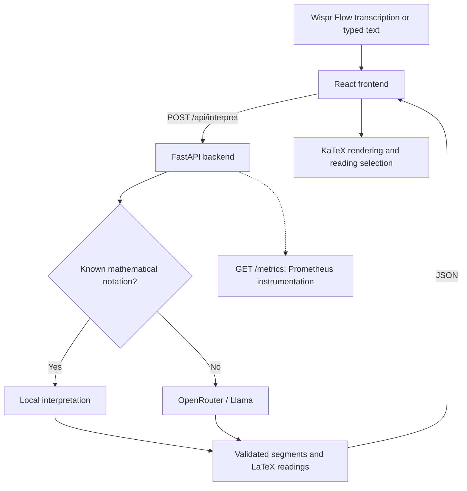

# Wispr Lecture

**Voice-first mathematical note-taking for university lectures.**

Wispr Lecture turns dictated mathematical language into readable, KaTeX-rendered notation. It accepts text transcribed by a tool such as [Wispr Flow](https://wisprflow.ai/), identifies mathematical expressions, and presents alternative interpretations when the wording is ambiguous.

For example:

> “For all epsilon greater than zero, there exists delta greater than zero.”
>
> **Rendered notation:** ∀ε > 0, ∃δ > 0

The goal is to preserve what was dictated—not to solve problems, change a mathematical claim, or silently fill in missing assumptions.

> **Project status:** Active prototype. Core note interpretation, a React interface, automated backend tests, and Prometheus instrumentation are implemented. Authentication, persistent note storage, rate limiting, and production deployment hardening are not yet implemented.
>
> Independent project; not affiliated with or endorsed by Wispr.

## Features

- **Speech-to-notation workflow:** Accepts already-transcribed text from Wispr Flow or manual entry; this app does not perform speech recognition itself.
- **Math-aware interpretation:** Separates ordinary prose from mathematical expressions and returns LaTeX readings for supported mathematical notation.
- **Ambiguity resolution:** Presents up to three distinct mathematical readings when an expression has multiple plausible meanings.
- **Fast path for known notation:** Recognizes a small set of patterns locally without an LLM call.
- **Graceful failure handling:** Preserves the original transcription in the frontend if AI interpretation is unavailable.
- **Observable backend:** Exposes request and LLM metrics in Prometheus format.

## Tech Stack

| Layer | Technology | Responsibility |
| --- | --- | --- |
| Frontend | React, TypeScript, Vite | Input, note display, interpretation choices |
| Math rendering | KaTeX | Renders LaTeX into mathematical notation |
| Backend | Python, FastAPI, Pydantic | Validates input and returns structured interpretations |
| Model integration | Llama 3.3 70B via OpenRouter (configurable) | Interprets text not handled by local rules |
| HTTP client | HTTPX (`AsyncClient`) | Reuses connections for nonblocking upstream calls |
| Observability | Prometheus client, FastAPI Instrumentator | Request, latency, and LLM outcome metrics |
| Testing and CI | `unittest`, GitHub Actions | Backend regression checks on PRs and pushes to `main` |

## Architecture



The backend receives **text, not audio**. For requests that require the model, it sends the transcription to OpenRouter and validates the returned structured interpretation. The frontend renders math locally with KaTeX. If the model fails, the note remains available as its original text.

## Getting Started

### Prerequisites

- Python **3.12**
- Node.js **22.12+** and npm (required by the project's Vite 8 toolchain; Node 20.19+ is also supported by Vite 8)
- An [OpenRouter API key](https://openrouter.ai/) for LLM-backed interpretations

Commands below assume you are in the repository root and use a macOS/Linux shell.

### 1. Start the Backend

```bash
cd backend
python3.12 -m venv .venv
source .venv/bin/activate
python -m pip install -r requirements.txt

# Required for LLM-backed interpretation, but not for known local patterns.
export OPENROUTER_API_KEY="your-openrouter-api-key"

uvicorn main:app --reload --port 8000
```

The API should be available at **http://localhost:8000**.

Check the health endpoint:

```bash
curl http://localhost:8000/api/health
# {"ok":true}
```

### 2. Start the Frontend

Open a second terminal from the repository root:

```bash
cd frontend
npm ci
npm run dev
```

Open **http://localhost:5173**.

In local development, Vite forwards `/api` requests to the backend running on port 8000.

`npm ci` installs the versions recorded in `frontend/package-lock.json`. Keep this lockfile committed; do not commit `node_modules/`.

### 3. Try an Interpretation

With the backend running, submit an expression handled by its local fast path:

```bash
curl -X POST http://localhost:8000/api/interpret \
  -H 'Content-Type: application/json' \
  -d '{"text":"(1 + x^2) / 2"}'
```

Example response:

```json
{
  "segments": [
    {
      "kind": "math",
      "content": "(1 + x^2) / 2",
      "readings": [
        "\\frac{1+x^2}{2}",
        "1+\\frac{x^2}{2}"
      ]
    }
  ]
}
```

This example requires no OpenRouter API key because the expression matches a locally recognized pattern. For an unfamiliar expression, the backend uses the configured OpenRouter model.

## Configuration

The backend reads configuration directly from environment variables. It does not automatically load `.env` files.

| Variable | Required | Default | Description |
| --- | --- | --- | --- |
| `OPENROUTER_API_KEY` | For model-backed requests | Unset | Credential for OpenRouter; keep it server-side and secret |
| `LLAMA_MODEL` | No | `meta-llama/llama-3.3-70b-instruct` | Model identifier used for interpretation |

If `OPENROUTER_API_KEY` is not set, recognized local notation still works; other valid interpretation requests return **503 Service Unavailable**.

**Never commit API keys, `.env` files, or other credentials.** In a deployed environment, use your hosting provider's secret-management mechanism.

## API Reference

| Method | Endpoint | Purpose |
| --- | --- | --- |
| `GET` | `/api/health` | Returns `{"ok": true}` |
| `POST` | `/api/interpret` | Validates a transcription and returns text/math segments with LaTeX readings |
| `GET` | `/metrics` | Exposes metrics in Prometheus text format |

### POST `/api/interpret`

**Request**

```json
{
  "text": "integral from a to b of x squared dx"
}
```

The `text` field is required, with an input limit of **1–2,000 characters**. Whitespace-only notes are rejected.

**Response shape**

```json
{
  "segments": [
    {
      "kind": "text",
      "content": "Original prose, punctuation, and spacing",
      "readings": []
    },
    {
      "kind": "math",
      "content": "Original mathematical wording",
      "readings": ["\\int_a^b x^2\\,dx"]
    }
  ]
}
```

This shows the schema, not a guaranteed response for any particular model-generated input. `text` segments have no LaTeX readings; `math` segments may contain several alternatives.

| HTTP status | Meaning |
| --- | --- |
| `200` | Interpretation returned |
| `422` | Invalid input, missing field, or blank transcription |
| `502` | Upstream model call failed or the model response was unusable |
| `503` | OpenRouter key missing for a request that requires model interpretation |

The frontend retains the user's original note when interpretation fails; HTTP errors are not silently converted into successful API responses.

## Observability

Prometheus-format metrics are available at **`GET /metrics`**.

| Metric | Type | Measures |
| --- | --- | --- |
| `http_requests_total` | Counter | HTTP request count by handler, method, and grouped status |
| `http_request_duration_seconds` | Histogram | Backend request duration |
| `llm_request_duration_seconds` | Histogram | Time spent waiting for a model response, including responses later found unusable |
| `llm_requests_total{outcome="..."}` | Counter | LLM calls categorized by `success`, `timeout`, `http_error`, or `invalid_response` |

Open the app at http://localhost:5173 to view the **Processing time** table. It refreshes every two seconds and shows cumulative seconds, average seconds per attempt, attempts, and errors for each stage. Totals include failed attempts and reset when the backend restarts. The same data is available as JSON at `GET /api/metrics/stages`.

Stage metrics are defined in `backend/metrics.py` and exposed at `/metrics`:

- `interpret_stage_runs_total{stage, outcome}` counts completed stage attempts.
- `interpret_stage_duration_seconds{stage, outcome}` measures duration, including failures.
- Stages: `input_check` (whitespace validation), `local_match`, `upstream_request` (request preparation, network wait, HTTP status check), `response_parse` (JSON and schema validation), and `latex_repair` (repair or empty-result fallback).
- Outcomes: `success` and `error`. Skipped stages do not increment. Local matching succeeds even when no pattern matches.

Average seconds per executed stage over five minutes:

```promql
sum by (stage) (rate(interpret_stage_duration_seconds_sum[5m]))
/
sum by (stage) (rate(interpret_stage_duration_seconds_count[5m]))
```

Estimated p95 per stage:

```promql
histogram_quantile(0.95,
  sum by (stage, le) (rate(interpret_stage_duration_seconds_bucket[5m]))
)
```

These measure backend processing. Existing HTTP metrics cover whole requests, including FastAPI validation and serialization. Desktop transcription, browser network time, and KaTeX rendering need separate client instrumentation. Stage averages describe only requests executing that stage, so do not sum averages across the local and model paths.

Known local-pattern matches do not call the model and therefore do not increment the LLM call counter. The LLM duration histogram does not currently record timeouts or upstream HTTP/connection failures.

```bash
curl http://localhost:8000/metrics
```

**Security:** `/metrics` is useful for development and monitoring, but should not be exposed openly on a production public interface. Restrict access to authorized monitoring infrastructure.

The current instrumentation exposes measurements; it does not itself provide a hosted Prometheus server, dashboard, alerting system, or load-testing infrastructure.

## Testing and Continuous Integration

From the repository root:

```bash
cd backend
source .venv/bin/activate
python -m unittest discover tests -v
```

Backend tests use mocked OpenRouter responses, so the test suite does not require an API key or live provider access.

Tests cover interpretation, rendering-related LaTeX handling, metrics, error outcomes, asynchronous request behavior, and HTTP-client lifecycle.

The GitHub Actions workflow in `.github/workflows/backend-tests.yml` runs backend tests on:

- Every pull request
- Every push to `main`

The workflow installs dependencies in Python 3.12 and runs the backend test suite.

**Branch protection must be configured separately** to require passing checks before merging.

## Repository Structure

```text
wispr-lecture/
├── backend/
│   ├── main.py                 # FastAPI endpoints and LLM integration
│   ├── requirements.txt        # Python dependencies
│   └── tests/                  # Backend tests
├── frontend/                   # React + TypeScript + Vite app
│   ├── package.json
│   └── package-lock.json
├── .github/
│   └── workflows/
│       └── backend-tests.yml   # Backend CI
├── .gitignore
└── README.md
```

## Deployment and Security

Wispr Lecture is currently an actively developed prototype. The following capabilities are required or recommended before exposing the application to public production traffic.

### Access Control and Abuse Prevention

Implement authentication if accounts are introduced, along with request rate limiting and AI usage quotas to protect against abuse and excessive model costs.

### Data Privacy

Treat lecture transcriptions as potentially sensitive user data. AI-backed requests are sent to OpenRouter for processing.

Production deployment should establish appropriate privacy disclosures, data retention policies, and safeguards against logging sensitive content.

### Secrets and Transport Security

Use HTTPS for communication between clients and the backend.

Store credentials using environment variables or a managed secrets service. Never expose the OpenRouter API key in frontend code.

### Availability and Scalability

The backend uses a shared asynchronous HTTP client to improve concurrency and reuse upstream connections.

Future production improvements include:

- Bounded concurrency for LLM requests
- Rate limiting and usage quotas
- Load testing to establish throughput and latency targets
- Horizontal scaling behind a load balancer
- Appropriate upstream error handling and backpressure

Asynchronous HTTP processing improves server efficiency but does not eliminate upstream provider rate limits.

### Monitoring

Restrict access to `/metrics` and configure external collection, dashboards, and alerts.

Use metrics to track request latency, error rates, LLM response times, and upstream failure categories.

### Persistent Storage

The current implementation does not provide persistent lecture note storage.

A database, data retention policy, and backup strategy should be introduced if cross-session saved notes become a supported feature.

### Production Deployment

Serve a production frontend build and run the backend using an appropriate production server configuration or managed hosting platform.

The development server command `uvicorn --reload` is intended for local development only.
